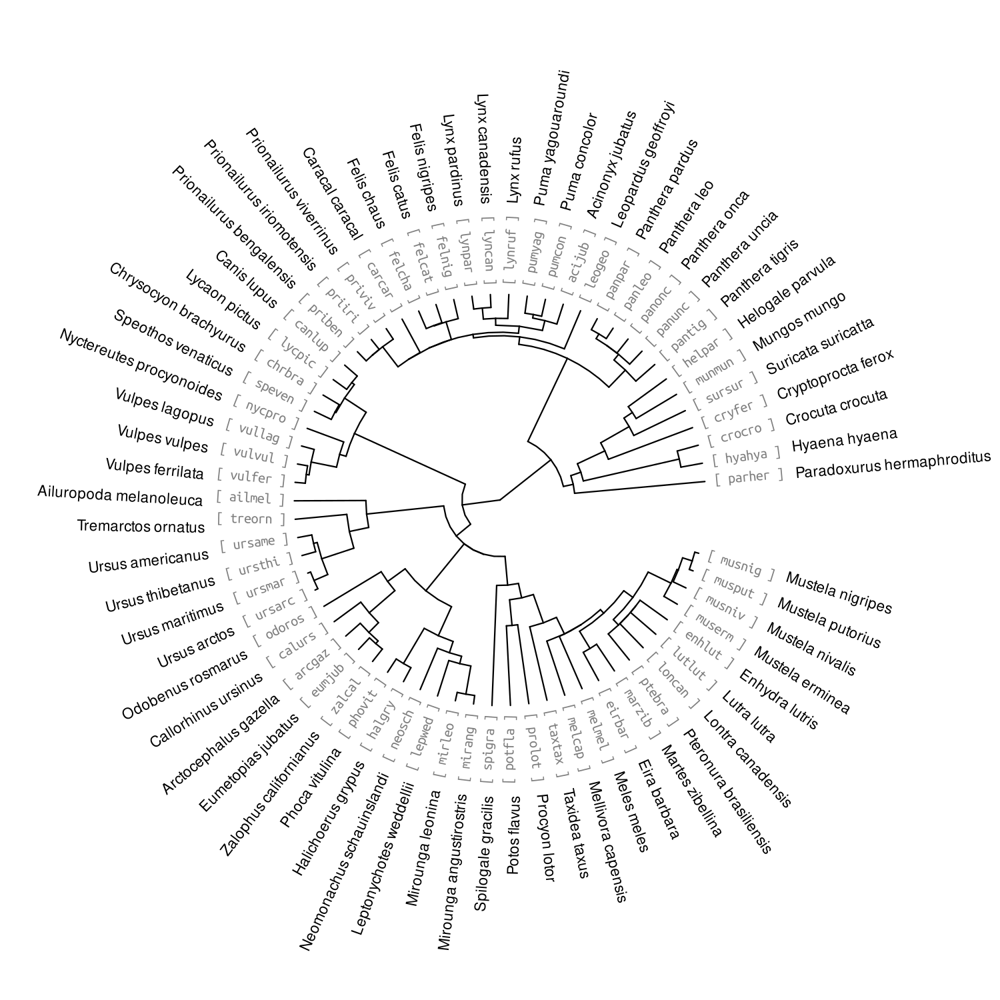

# Carnivora cactus alignment

[](https://doi.org/10.5281/zenodo.23701524)

**Author:** Kosmas Hench

This repository contains the code for creating a reference free whole-genome alignment for Carnivora using `cactus` `🌵`, as well as the construction of a custom `SNPeff` data base for the reference genome of the Antarctic fur seal (*Arctocephalus gazella*, `arcGaz4_h1`, published in Hench *et al.* 2024).


## Background

The purpose is to provide resources for population genetic analysis using the *A. gazella* reference genome concerned with estimating mutation load.  
Specifically, the repository provides the code to:
  - download a set of 67 carnivora reference genomes from NCBI
  - align these genomes using `cactus` to create a `hal` file
  - convert the `hal` file into an *A. gazella* specific `maf` file
  - run `gerp++` on the `maf` file to create conservation scores along the *A. gazella* genome (conservation across the clade carnivora, based on the 67 carnivora species)
  - create a custom `SNPeff` database for the *A. gazella* genome

## Overview

The code is managed using `snakemake`, with the script `code/workflow/snakefile` as the main backbone. 🐍

The individual sub-tasks are then distributed over scripts located within the folder `code/workflow/rules/`.
The code can be executed incrementally from within the directory `code/`, eg:

```sh
cd code/
snakemake -n -R ncbi_download
```

### Genome Download

...happens within `code/workflow/rules/intial_dl.smk`.

All genomes listed in `data/carnivora_genome_and_timetree.tsv` are downloaded from NCBI and checked if repeat-masked (that is, checked for containing *upper* and *lower case* bases, e.g. `A`/`a`)

The list is an intersection of all carnivora genomes available at the onset of the study, and those species included in the [timetree](https://timetree.org/) dataset at the same time.
This intersection includes the following species / phylogeny:



### Genome Alignment

...happens within `code/workflow/rules/cactus_prep.smk` and `cactus_stepwise.smk`.

This was a rather fiddly business 🙄, running a `toil`-operated process within `snakemake` on an HPC, depending on a containerized environment. 

The whole operation is a two-step process, where first the `cactus` instructions are being produced as plain `bash` scripts (`cactus_prep.smk`).
Once the instructions are compiled, `cactus_stepwise.smk` works its way up in several rounds from the tips of the phylogeny to the root iterating over the pair-wise alignments and in the end producing `results/cactus/carnivora_set.hal` (the 143Gb 67-genome alignment).

### Alignment Conversion

...happens within `code/workflow/rules/hal_conversions.smk`.

To use the 67-genome for the *A. gazella* genome, the alignment is converted into `maf` format, using *A. gazella* as reference.

Additionally, the ancestral state of SNPs differing between *A. gazella* and the inferred ancestral genome is determined (with the ancestral genome being the genome two nodes up from *A. gazella*, `"Anc41"`)

### Calling Conservation Scores

...happens within `code/workflow/rules/neutral_branch_lengths.smk`

This horribly named script re-estimates the branch lengths of the initial phylogeny in terms of genetic distance (which timetree provides in terms of years). This conversion is necessary to be able to provide conservation scores by `gerp++`, which are typically referring to genetic distance.

👉 Conservation scores are estimated using the `maf` and re-scaled phylogeny with `gerpcol`.
The results are then converted to `bed` format, which can be used to annotate genotypes within `vcf` files.


### Creation `SNPeff` Database for Functional Annotation

...happens within `code/workflow/rules/build_snpeff_db.smk`

This chunk of the analysis is used for the creation of a custom `SNPeff` data base for the *A. gazella* reference genome, based on the genome itself (`fasta` file) and the genome annotation (`gff`, `gtf`)

👉 the resulting folder `results/snp_eff` *is* the database that can be used for the annotation of *A. gazella* based `vcf` files, using `snpEff ann`.

### Misc, bits and bops...

The other `.smk` files contain small things I needed to go down weird rabbit holes, follow side quests, red herrings and shave unrelated yaks...

...sorry for the mess 🤷 (might clean later, provided I find the time 🫠)

## References

Hench K, Vendrami DLJ, Forcada J, Hoffman JI (2024). [Refinement of the Antarctic Fur Seal (*Arctocephalus Gazella*) Reference Genome Increases Continuity and Completeness](https://doi.org/10.1093/g3journal/jkae179). G3 Genes|Genomes|Genetics 14, jkae179.